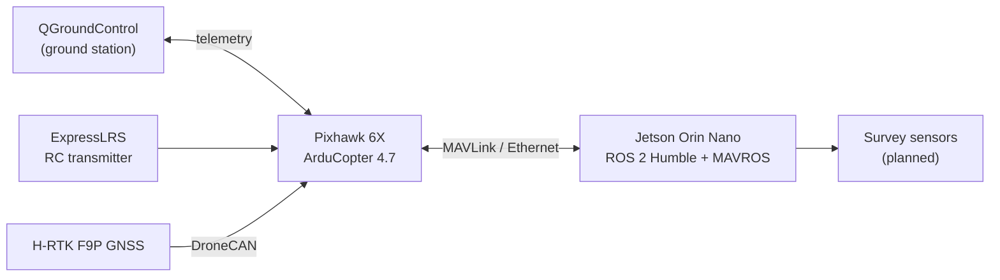

# X500 Survey Drone

A Holybro X500 quadcopter built from the frame up as a survey platform for ecological and geospatial mapping. It supports fieldwork for my M.S. in Geographic Information Science at San Francisco State University.

**Status:** first-flight test protocol passed in November 2026: hover, AltHold, Loiter, and in-air radio failsafe. Post-incident inspection is in progress; tuning, sensor integration, and the first mapping mission are next.

  

## In the field

https://github.com/user-attachments/assets/baba1b58-a19a-430d-8238-f0993afd1e11

<table>
  <tr>
    <td width="50%"></td>
    <td width="50%"></td>
  </tr>
  <tr>
    <td align="center"><em>Ready for a test flight</em></td>
    <td align="center"><em>Field ground station: QGroundControl and ExpressLRS transmitter</em></td>
  </tr>
</table>

## Why I'm building it

Data you can trust starts with a platform you understand. I built this aircraft myself to understand the whole system:

- **Hardware:** frame, motors, ESCs, power distribution, and how every component works together
- **Software:** flight controller firmware, parameters, calibration, and the tuning that turns a pile of parts into a stable aircraft
- **Flying:** how inputs, conditions, and setup choices show up in the air

When something works, I want to know why. When something doesn't, I want to be able to diagnose it myself instead of guessing.

## System stack

| Layer | Component |
|---|---|
| Airframe | Holybro X500 |
| Flight controller | Pixhawk 6X |
| Flight firmware | ArduPilot (ArduCopter 4.7) |
| Companion computer | NVIDIA Jetson Orin Nano, JetPack 6.2 |
| Robotics middleware | ROS 2 Humble + MAVROS |
| FC ↔ companion link | MAVLink over Ethernet |
| Positioning | Holybro H-RTK F9P GNSS over DroneCAN |
| Ground control | QGroundControl |
| RC link | ExpressLRS |

## Architecture

The Jetson runs alongside the flight controller and talks to it over MAVLink on Ethernet. That link is the foundation for onboard processing and autonomy: the flight controller keeps the aircraft stable, and the Jetson handles mission logic and sensor data.

## Documentation

| Document | What it covers |
|---|---|
| [Operator's manual](docs/operators-manual.md) | Every component and how it is configured: batteries, airframe and power, Pixhawk parameters and failsafes, GPS, ELRS radio, telemetry, ground station, Jetson, software stack, onboard links |
| [Field checklist](docs/field-checklist.md) | Packing, site check, power-up order, preflight, survey mission, emergency procedures, power-down |
| [Test flight protocol](docs/test-protocol.md) | Phased first-flight protocol with abort criteria, and results |
| [Troubleshooting and incident log](docs/troubleshooting.md) | Every fault hit during the build and its fix, plus the 2026-11-08 loss-of-thrust incident report |
| [Parameter file](config/X500_2026-11-06_Params.params) | Full ArduCopter parameter export |

## Flight controller configuration

Full parameter export: [`config/X500_2026-11-06_Params.params`](config/X500_2026-11-06_Params.params) (ArduCopter 4.7.0, exported from QGroundControl on November 6, 2026).

| Area | Configuration |
|---|---|
| Frame | Quad X |
| GNSS | H-RTK F9P on DroneCAN at 5 Hz; dual compasses, external primary |
| State estimation | EKF3: GPS for horizontal position and velocity, barometer for altitude, compass for yaw |
| Companion link | Pixhawk Ethernet enabled with a static IP, streaming MAVLink2 over UDP (port 14550) to the Jetson |
| RC | ExpressLRS receiver on SERIAL2; receiver-reported RSSI |
| Switches | Flight modes on channel 6 (Stabilize / AltHold / Loiter), RTL on channel 7, arm/disarm on channel 5 |
| Power | 4S 5200 mAh battery with a digital power monitor |
| Failsafes | RC loss → RTL; low battery (14.0 V) → RTL; critical battery (13.6 V) → Land; EKF failsafe → Land; crash and vibration checks on |
| Return to launch | 15 m RTL altitude |

**Test record at export:** 28 flights, about 13 minutes total flight time (from the flight controller's onboard statistics).

## Roadmap

- [x] Assemble airframe and power system
- [x] Configure ArduCopter on the Pixhawk 6X
- [x] Bring up Jetson Orin Nano with ROS 2 Humble and MAVROS
- [x] MAVLink link between flight controller and companion computer
- [x] First-flight test protocol, Phases 1–5 ([results](docs/test-protocol.md#results))
- [ ] Post-incident inspection and repeat of the test protocol
- [ ] AutoTune (roll, pitch, and yaw rate gains are still at ArduPilot defaults)
- [ ] Vibration analysis and harmonic notch filter setup
- [ ] Enable the configured geofence (100 m ceiling, 300 m radius)
- [ ] Survey sensor integration
- [ ] First mapping mission and processed orthomosaic
- [ ] Compare RTK-tagged imagery against ground control points

## Operations

All flights are conducted by an FAA Part 107 certificated remote pilot.

## License

Configuration files and documentation in this repository are released under the [MIT License](LICENSE).

## Related

Part of my GIS and remote sensing work. See my [profile](https://github.com/Stayoutdoors) for other projects.

---

Garrett Hebert · FAA Part 107 remote pilot · [LinkedIn](https://www.linkedin.com/in/garrett-hebert-285506126/)
