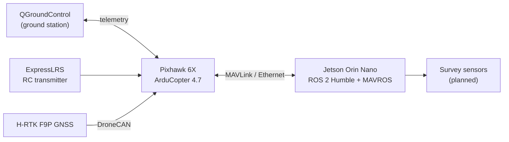

# X500 Survey Drone

A Holybro X500 quadcopter built from the frame up as a survey platform for ecological and geospatial mapping. It supports fieldwork for my M.S. in Geographic Information Science at San Francisco State University.

**Status:** first test flights complete (November 2026). Tuning, sensor integration, and the first mapping mission are next.

## Why build it

Data you can trust starts with a platform you understand. I built this aircraft myself to understand the whole system:

- **Hardware:** frame, motors, ESCs, power distribution, and how every component works together
- **Software:** flight controller firmware, parameters, calibration, and the tuning that turns a pile of parts into a stable aircraft
- **Flying:** how inputs, conditions, and setup choices show up in the air

When something works, I want to know why. When something doesn't, I want to be able to diagnose it myself instead of guessing.

## System stack

| Layer | Component |
|---|---|
| Airframe | Holybro X500 |
| Flight controller | Pixhawk 6X |
| Flight firmware | ArduPilot (ArduCopter 4.7) |
| Companion computer | NVIDIA Jetson Orin Nano, JetPack 6.2 |
| Robotics middleware | ROS 2 Humble + MAVROS |
| FC ↔ companion link | MAVLink over Ethernet |
| Positioning | Holybro H-RTK F9P GNSS over DroneCAN |
| Ground control | QGroundControl |
| RC link | ExpressLRS |

## Architecture

The Jetson runs alongside the flight controller and talks to it over MAVLink on Ethernet. That link is the foundation for onboard processing and autonomy: the flight controller keeps the aircraft stable, and the Jetson handles mission logic and sensor data.

## Roadmap

- [x] Assemble airframe and power system
- [x] Configure ArduCopter on the Pixhawk 6X
- [x] Bring up Jetson Orin Nano with ROS 2 Humble and MAVROS
- [x] MAVLink link between flight controller and companion computer
- [x] First test flights
- [ ] Extended flights and PID tuning
- [ ] Survey sensor integration
- [ ] First mapping mission and processed orthomosaic
- [ ] Compare RTK-tagged imagery against ground control points

## Related

Part of my GIS and remote sensing work. See my [profile](https://github.com/Stayoutdoors) for other projects.

---

Garrett Hebert · FAA Part 107 remote pilot · [LinkedIn](https://www.linkedin.com/in/garrett-hebert-285506126/)
